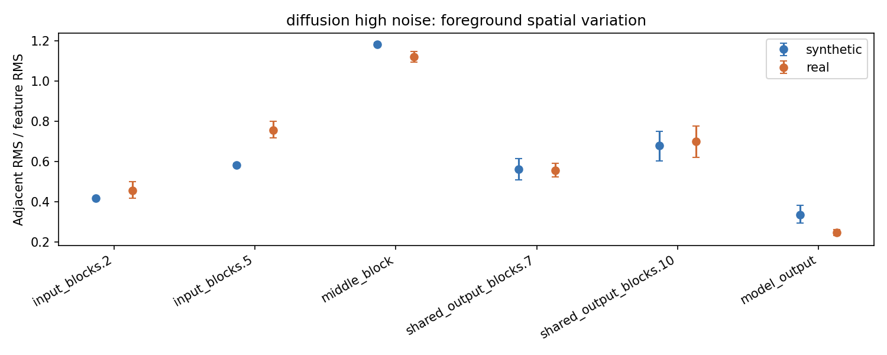
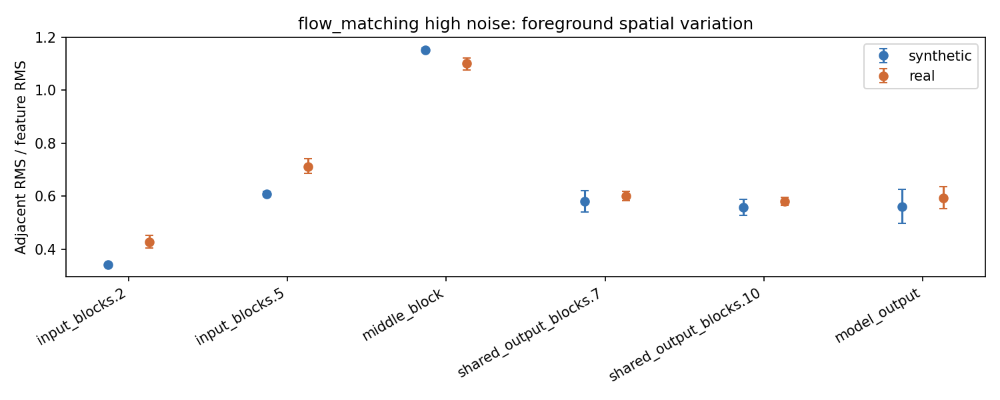
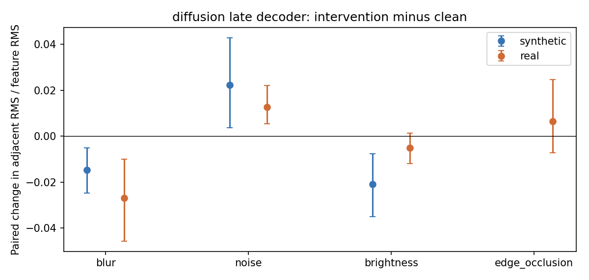
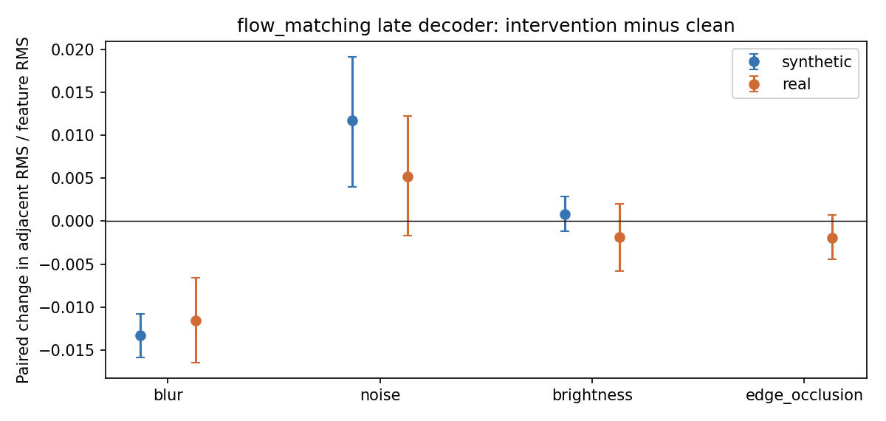
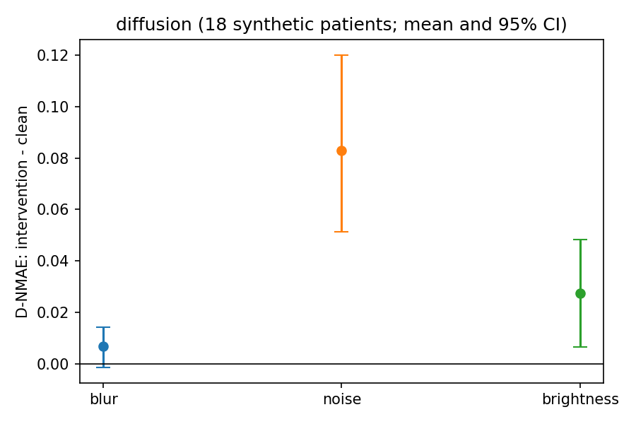
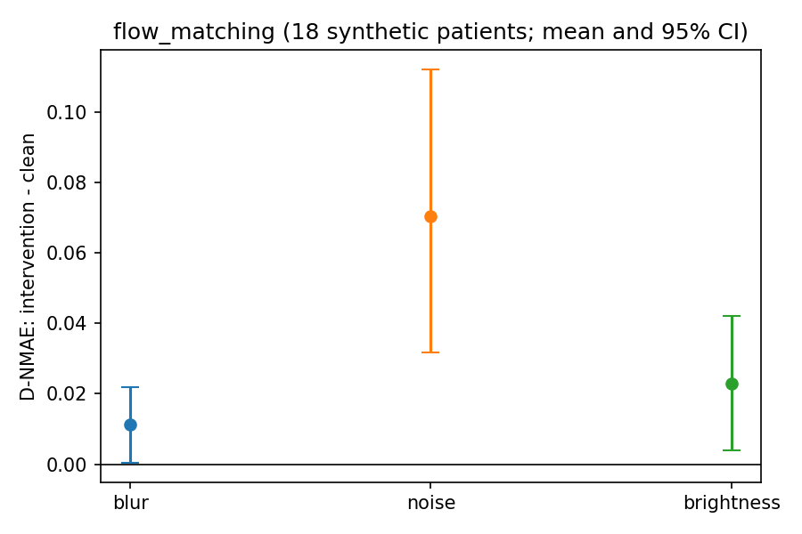

# 真实与合成侧位片的特征空间变化

冻结模型的开发性对照，使用 18 名合成验证患者与 18 张真实图像；真实图像是否来自独立患者未知。每域使用原有的输入映射：合成 raw、真实 quantile。两种模型、最高噪声和低噪声采用固定纯噪声 N 探针；低噪声不在原生采样轨迹上。真实片没有配对 D 或解剖语义真值。

## 不同层的原始多通道变化

图中是最高噪声下，每图前景相邻格特征 RMS 除以特征 RMS 的平均值和图像级 95% bootstrap 区间；只在同一层内比较两个域。late decoder 的真实减合成：diffusion +0.0183（[-0.0926, 0.1257]），Flow +0.0220（[-0.0121, 0.0580]），区间均跨零。不能据此确认这项多通道指标普遍更高。

同一层 PCA-RGB 的真实减合成分别为 +0.0126（[0.0052, 0.0214]）和 -0.0052（[-0.0084, -0.0021]）。中间层也出现 PCA 与原始多通道邻差方向不一致：多通道为 diffusion -0.0619、Flow -0.0523，PCA 均为正。PCA 在预选六张图上拟合前三主成分并使用共同显示范围；三通道投影、归一化和裁剪会影响观感。这些结果不支持仅凭颜色更碎判断完整表征或语义更差。

## 同图输入干预

图为最高噪声 late decoder 的干预减干净图，按图像配对 bootstrap；前景遮罩固定。模糊、加噪和亮度在模型条件空间实施，右侧固定 10% 带遮挡仅用于真实图；遮挡可制造边界，不能视为精确移除设备标记。不同输入映射、视野和采集条件共同影响域比较，不能将差异归因于某一种因素。

## 特征变化与合成 D 误差

在 18 名合成患者中，加入固定强度的噪声后，D-NMAE 相对干净输入的平均变化为 diffusion +0.0830（95% CI [0.0515, 0.1199]），Flow +0.0705（[0.0317, 0.1121]）。三种干预合并的患者内 clean-relative 特征变化与 D 误差变化 Spearman 相关，在高噪声中间层为 0.508（[0.269, 0.705]）和 0.341（[0.063, 0.563]）；按患者组 bootstrap，干预种类可能混杂该关联。Flow late decoder 为 0.050（[-0.215, 0.347]）。固定噪声探针与完整采样输出的关联不证明因果。

## 实现与边界

冻结模型对选定层同时保存原生分辨率和 32×32 特征，分别计算相邻格变化、Hann 加窗 AC 频谱、PCA-RGB 和位置检索；各层原生尺寸及分析区域不同，不能直接跨层比较频率。位置检索是几何代理，没有真实解剖对应标注。GPU 两模型队列、受控合成采样均完成；权重状态与旧特征缓存校验通过。无模型训练、冻结测试集调参或真实 D 准确率结论。病例级图和缓存不随仓库发布。
