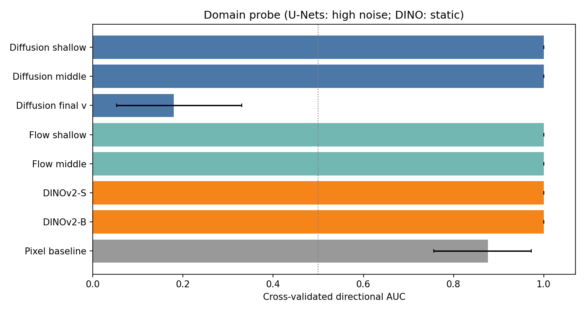
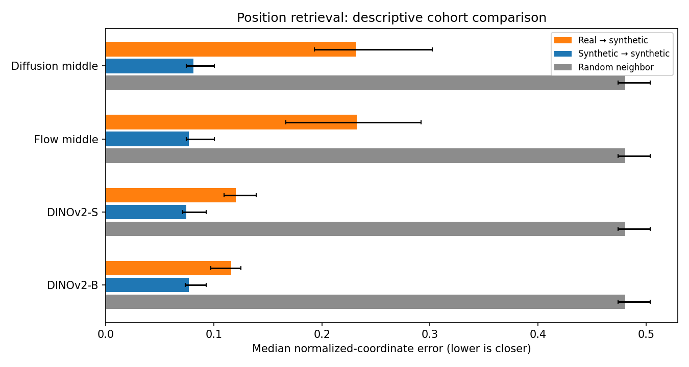
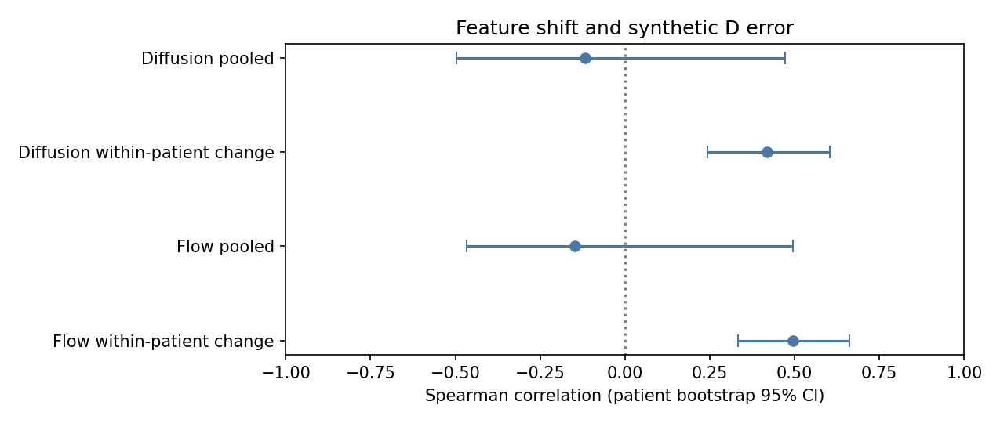

# 冻结模型表征分析：图文报告

本研究比较冻结的 D-only diffusion、Flow 与 DINOv2 表征。样本为36名合成训练患者、18名留出合成患者和18张固定抽取的真实图像；受控退化使用10名验证患者。真实图像没有配对左右真值，也未确认来自18名不同患者。图中区间为图像或患者分组 bootstrap 95% 置信区间，条件于固定权重及已拟合的参考空间和验证折。

## 1. 两个域在哪些位置可分？

在预先指定的高噪声切片中，diffusion 和 Flow 的浅层、中间层，以及 DINOv2-S/B 的域分类 AUC 均为 1.00（每域18张）。diffusion 最终单通道 v 输出的方向性 AUC 为 0.179（95% CI [0.052, 0.330]）；低于 0.5 不应直接解释成域混合。图中灰线对应局部像素对照，虚线为 0.5。

这些分数描述本次样本的域信息，而不是左右分解准确率。AUC 汇集了不同交叉验证折的预测，真实域样本量也有限。DINO 的域可分性没有低于浅层 U-Net，不能据此断言 DINO 不包含有用结构信息。

## 2. 位置检索保留了什么？

图中 diffusion/Flow 使用高噪声中间层。真实→合成的位置误差中位数分别为 0.232（95% CI [0.193, 0.302]）和 0.232（[0.166, 0.292]）；DINOv2-S/B 分别为 0.120（[0.109, 0.139]）和 0.116（[0.097, 0.125]）。每组18张，随机邻居约为 0.481。

位置在自动前景包围盒内归一化；视野、器械标记和噪声都可能影响结果。没有真实 landmark 真值，因此该指标只是粗略空间代理，不能证明真实解剖语义对应。

## 3. 表征偏移与 D 误差有何关系？

在10名验证患者、预先指定的高噪声中间层，diffusion 和 Flow 的池化 Spearman ρ 分别为 −0.117（95% CI [−0.497, 0.472]）和 −0.147（[−0.466, 0.495]）。相对于同一患者干净输入的变化，ρ 分别为 0.418（[0.243, 0.604]）和 0.496（[0.333, 0.661]）。患者 bootstrap 保留每人的所有退化；scale=0.7 的 quantile 映射在10例中无定义，已跳过，raw 对照保留。

两种比较反映不同问题，退化类型仍可能影响相关性。真实图像只用于描述特征偏移位置，不能估计其 D 误差；这些相关性不能证明表征对齐会改善重建。

## 方法与边界

N 模式在六个噪声水平使用同一张固定噪声图；O 在合成 D 上加噪；T 读取原生采样轨迹并记录实际调用时间。低噪声 N 是离轨迹诊断。真实输入主协议使用 quantile 映射；MMD 域比较和合成参照共享训练参考带宽。自动前景可能包含颈部或器械标记。

未训练模型、修改默认预处理、重标解剖侧别或使用锁定测试集。完整逐层结果、代表病例及全部统计保留在本地；本报告仅包含汇总图。实现与假设结论见[简短实现总结](REPRESENTATION_ANALYSIS.md)。
